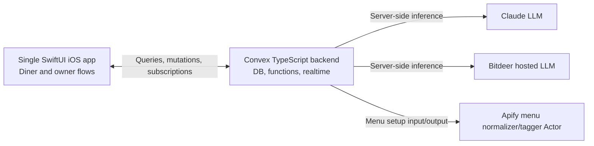

# TappyTabs Software Design

> MVP implementation guide. Product behavior and demo requirements live in [README.md](README.md); this document focuses on how to build them.

## 1. System overview

One native iOS app serves diners and restaurant owners through selectable modes. For the MVP, a device ID identifies a diner profile and the selected mode is stored on the device; production-style account authentication is a should-have. A Convex TypeScript backend owns shared data, session state, realtime updates, and server-side integrations. The MVP uses a seeded mock menu, Claude and Bitdeer for LLM work, and the project’s Apify Actor to normalize and tag the menu.

**Design priorities:** get one end-to-end restaurant session working quickly; keep allergy filtering and order math deterministic; make agent/model failure degrade to a valid, explainable order.

## 2. Architecture

The iOS app uses the Convex Swift client. Convex queries and mutations handle validated reads and writes; subscriptions keep both roles current. Convex actions call Claude, Bitdeer, and Apify so API keys stay server-side. Use small provider wrappers and structured-output validation for model calls.

### Main components

- **iOS app:** mode selection, diner profile, seeded restaurant setup, UWB join, hunger, agent conversation, dish selection, group confirmation.
- **Convex data/functions:** users, restaurants, menu, sessions, membership, negotiation, order; enforce role and membership checks on every write.
- **Negotiation workflow:** filter eligible dishes in code, request structured proposals and votes from the configured model steps, validate returned menu IDs, run a fixed number of rounds, then apply deterministic tie-breaks and totals. LLD defines which steps use Claude versus Bitdeer.
- **Menu Actor:** required in the MVP. It accepts the hand-authored mock menu and returns normalized menu records with keyword and Bitdeer-enriched allergen/diet tags and an uncertainty marker. `may_contain` items are eligible with an “ask your server” label. The same Actor can process menu data from an optional scraper later.

## 3. Key flows

### Account and setup

1. On first use, select diner or restaurant mode. The MVP uses a device ID for the profile and stores the selected mode locally; no account signup is required.
2. Diners complete onboarding and save taste preferences to their Convex profile. The demo restaurant and raw mock menu are seeded for the MVP.
3. Run the project's Apify normalizer/tagger Actor on the mock menu, validate its result in Convex, and store the normalized menu. Re-run only when source menu data changes.

**Should-have restaurant setup:** add authentication and an owner account. The owner enters a Google Maps location; a separate Apify scraper Actor uses it to find menu data and prefill the restaurant profile. The owner reviews and edits those items, then the project’s existing normalizer/tagger Actor processes the edited data. This scraper is an optional convenience, not the MVP menu dependency.

### Join and order

Nearby Interaction provides UWB ranging; Multipeer Connectivity discovers the other app and exchanges the temporary discovery tokens required to begin ranging. The restaurant phone advertises while in host/join mode; the diner phone joins when measured distance crosses a configured threshold. QR join remains the fallback described in the README. This requires compatible UWB iPhones for the primary join path. (Apple documents Nearby Interaction and token exchange in its [framework overview](https://developer.apple.com/documentation/nearbyinteraction).)

The backend starts one bounded workflow after the owner starts the party: filter each diner’s candidates; draft proposals; negotiate a group plan for a fixed number of rounds; publish the validated plan. Stage 1 records each diner’s pick. Stage 2 records group edits and each diner’s confirmation. A mutation checks the current phase and membership before accepting every change.

## 4. Data model

Keep the schema small; use Convex document IDs for relationships.

| Collection | MVP fields |
|---|---|
| `users` | device ID, name, allergies, diet, likes/dislikes, cuisines, spice, avatar, optional profile summary |
| `restaurants` | name, menu version, optional Maps location and owner association for the should-have setup |
| `menuItems` | restaurant ID, name, category, price in cents, description, ingredients, allergen/diet tags, uncertainty flag |
| `sessions` | restaurant ID, host ID, party size, status/phase, member IDs, timestamps |
| `sessionMembers` | session ID, user ID, hunger, selected dish ID, confirmation state |
| `messages` | session ID, speaker, text, sequence number |
| `orders` | session ID, status, total cents |
| `orderItems` | order ID, menu item ID, quantity, shared flag, optional diner ID |

Convex schema validators enforce field types and required values. Store prices as integer cents. Past visits are a stretch goal; do not build history-dependent recommendations into the MVP.

## 5. External and device interfaces

- **Convex:** Swift client calls queries/mutations/actions and subscribes to session/order queries over Convex’s realtime connection.
- **Claude and Bitdeer:** Convex actions call the model assigned to each step in the LLD. Require structured output containing known menu IDs; reject malformed or ineligible IDs. Use deterministic fallback behavior if calls fail or time out.
- **Apify:** Convex action starts the project Actor with mock menu JSON, obtains its structured output, validates it, then stores the normalized menu. A separate scraper Actor is a should-have input source for owner setup; it does not replace the project Actor.
- **UWB and QR:** iOS Nearby Interaction plus Multipeer Connectivity for peer discovery and discovery-token exchange. UWB proximity triggers a Convex join mutation; QR join is the fallback. Neither carries app/session state.

## 6. Safety, access, and failure handling

- MVP identity is a device ID; the local app mode can be changed. Restrict each party operation to its host or members. Adding authenticated owner accounts is a should-have.
- Keep Claude, Bitdeer, and Apify credentials in server-side environment secrets. Do not ship provider keys in the iOS app.
- Allergy and diet filters run before model calls. `contains` is unsafe; `may_contain` remains eligible with an “ask your server” warning, per the LLD. Shared items must pass the rule for every sharer. LLM output cannot add items or bypass those checks.
- Negotiation uses fixed rounds, bounded request timeouts, output validation, and a deterministic tie-break. Store progress/messages as work completes so subscribed clients can render it; on provider failure, publish the best valid candidate plan.
- Use the LLD's 45-second pick and confirm deadlines; the server auto-picks the agent's top choice and auto-confirms for a diner who does not respond.
- A lost connection reconnects through the Convex client and subscriptions. UWB join requires local peer discovery plus internet access for the Convex mutation; show a clear join failure if either step fails.

## 7. Deployment

Use one Convex development deployment for the demo, with secrets for Claude, Bitdeer, and Apify. Run the project Actor from Apify. Install the same iOS app build on all phones and configure its Convex deployment URL. No CI/CD or separate staging environment is needed for the PoC.

## 8. MVP implementation order

1. Convex schema, device-ID profile, seeded mock menu.
2. Owner creates a session; diner joins through UWB; realtime member list.
3. Deterministic allergy filtering and order state, then confirmation screens.
4. Apify menu-normalizer Actor and Convex integration.
5. Claude/Bitdeer agent steps and streamed/persisted conversation display, following the LLD's provider assignment.
6. Polish reconnect, model fallback, and the demo path.

**Should-have:** authentication and self-service restaurant profile creation. A separate Apify scraper Actor uses the owner’s Google Maps location to find a menu and prefill the editable menu section. The owner reviews/edits the items; the project normalizer/tagger Actor then processes them. This only speeds restaurant setup and is not required for the MVP.

> The project README remains authoritative for product requirements and the demo checklist.
