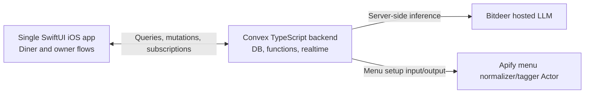
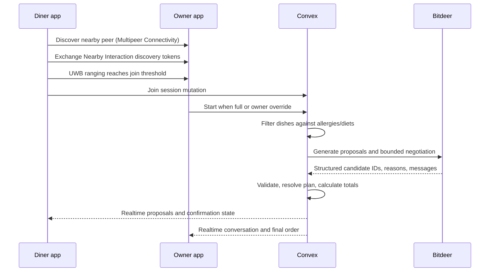

# TappyTabs Software Design

> MVP implementation guide. Product behavior and demo requirements live in [README.md](README.md); this document focuses on how to build them.

## 1. System overview

One native iOS app serves diners and restaurant owners. Signup assigns a permanent role. A Convex TypeScript backend owns shared data, session state, realtime updates, and server-side integrations. The MVP uses a seeded mock menu, Bitdeer for LLM inference, and an Apify Actor to normalize and tag that menu.

**Design priorities:** get one end-to-end restaurant session working quickly; keep allergy filtering and order math deterministic; make agent/model failure degrade to a valid, explainable order.

## 2. Architecture

The iOS app uses the Convex Swift client. Convex queries and mutations handle validated reads and writes; subscriptions keep both roles current. Convex actions call Bitdeer and Apify so API keys stay server-side. Use a single Bitdeer model behind a small `ModelProvider` wrapper so prompts and structured output validation are isolated from provider details.

### Main components

- **iOS app:** auth/role selection, diner profile, owner restaurant setup, UWB join, hunger, agent conversation, dish selection, group confirmation.
- **Convex data/functions:** users, restaurants, menu, sessions, membership, negotiation, order; enforce role and membership checks on every write.
- **Negotiation workflow:** filter eligible dishes in code, request structured proposals from Bitdeer, validate returned menu IDs, run a fixed number of rounds, then apply deterministic tie-breaks and totals.
- **Menu Actor:** accepts the hand-authored mock menu and returns normalized menu records with ingredient-derived allergen/diet tags and an `uncertain` marker. Uncertain dishes are flagged for server confirmation and excluded from unsafe recommendations.

## 3. Key flows

### Account and setup

1. User signs up and chooses diner or restaurant owner; role is immutable for the MVP.
2. Diners save taste preferences to their profile. Owners create the demo restaurant and load its seeded mock menu.
3. Owner menu setup sends the mock menu to the Apify Actor through a Convex action; Convex validates and stores the normalized result. A rerun is only needed when the source menu changes.

### Join and order

Nearby Interaction provides UWB ranging; Multipeer Connectivity discovers the other app and exchanges the temporary discovery tokens required to begin ranging. The restaurant phone advertises while in host/join mode; the diner phone joins when measured distance crosses a configured threshold. This requires both apps foregrounded and compatible UWB iPhones, as in the README. (Apple documents Nearby Interaction and token exchange in its [framework overview](https://developer.apple.com/documentation/nearbyinteraction).)

The backend starts one bounded workflow after the owner starts the party: filter each diner’s candidates; draft proposals; negotiate a group plan for a fixed number of rounds; publish the validated plan. Stage 1 records each diner’s pick. Stage 2 records group edits and each diner’s confirmation. A mutation checks the current phase and membership before accepting every change.

## 4. Data model

Keep the schema small; use Convex document IDs for relationships.

| Collection | MVP fields |
|---|---|
| `users` | auth subject, immutable role, name, allergies, diet, likes/dislikes, cuisines, spice, avatar |
| `restaurants` | owner user ID, name, menu version |
| `menuItems` | restaurant ID, name, category, price in cents, description, ingredients, allergen/diet tags, uncertainty flag |
| `sessions` | restaurant ID, host ID, party size, status/phase, member IDs, timestamps |
| `sessionMembers` | session ID, user ID, hunger, selected dish ID, confirmation state |
| `messages` | session ID, speaker, text, sequence number |
| `orders` | session ID, status, total cents |
| `orderItems` | order ID, menu item ID, quantity, shared flag, optional diner ID |

Convex schema validators enforce field types and required values. Store prices as integer cents. Past visits are a stretch goal; do not build history-dependent recommendations into the MVP.

## 5. External and device interfaces

- **Convex:** Swift client calls queries/mutations/actions and subscribes to session/order queries over Convex’s realtime connection.
- **Bitdeer:** Convex action calls the chat completion API with only eligible menu items and the minimum profile/session context. Require structured output containing known menu IDs; reject malformed or ineligible IDs. Use a safe deterministic fallback if the call fails or times out.
- **Apify:** Convex action starts the project Actor with mock menu JSON, obtains its structured output, validates it, then stores it as the restaurant menu. The Actor standardizes tags; it is not the runtime source of menu truth.
- **UWB:** iOS Nearby Interaction plus Multipeer Connectivity for peer discovery and discovery-token exchange. UWB proximity triggers a Convex join mutation; it does not carry app/session state.

## 6. Safety, access, and failure handling

- Use Clerk with the Convex Swift client. Store the permanent role in the Convex user profile and check it in backend functions. Owners can manage only their restaurant; diners can read/write only their own profile and sessions they joined.
- Keep Bitdeer and Apify credentials in Convex environment secrets. Do not ship provider keys in the iOS app.
- Allergy and diet filters run before model calls. Shared items must satisfy every diner who will share them. Unknown ingredient/allergen status is marked uncertain and not presented as safe. LLM output cannot add items or bypass those checks.
- Negotiation uses fixed rounds, bounded request timeouts, output validation, and a deterministic tie-break. Store progress/messages as work completes so subscribed clients can render it; on provider failure, publish the best valid candidate plan.
- A lost connection reconnects through the Convex client and subscriptions. UWB join requires local peer discovery plus internet access for the Convex mutation; show a clear join failure if either step fails.

## 7. Deployment

Use one Convex development deployment for the demo, with secrets for Bitdeer and Apify. Run the Apify Actor from the Apify platform. Install the same iOS app build on all phones and configure its Convex deployment URL. No CI/CD or separate staging environment is needed for the PoC.

## 8. MVP implementation order

1. Convex schema, auth/profile with permanent role, seeded mock menu.
2. Owner creates a session; diner joins through UWB; realtime member list.
3. Deterministic allergy filtering and order state, then confirmation screens.
4. Apify menu-normalizer Actor and Convex integration.
5. Bitdeer candidate generation/negotiation and streamed/persisted conversation display.
6. Polish reconnect, model fallback, and the demo path.

> The project README remains authoritative for product requirements and the demo checklist.
