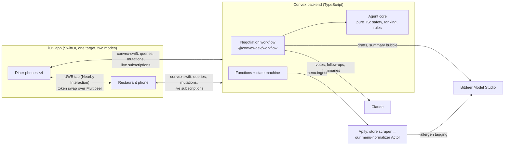

# TappyTabs — High-Level Design

Oct 24, 2026 · supersedes `SOFTWARE_DESIGN.md` and `TappyTabs — Low-Level Design.md`

> Product requirements and the demo script live in [README.md](../README.md) (the PRD), which stays authoritative. This doc covers how the system is built and why. Per-role build detail is in [IMPLEMENTATION_DESIGN.md](IMPLEMENTATION_DESIGN.md).

## 1. System overview

One native iOS app runs in two modes: **diner** and **restaurant**. A Convex TypeScript backend owns all shared state, the party state machine, realtime sync and the agent negotiation. Claude and Bitdeer provide the language work. An Apify pipeline (a store scraper plus our own published normalizer Actor) produces the real menu. Phones join a table by an ultra-wideband tap, with QR as the fallback.

**Design priorities, in order:**

1. **Nobody is ever recommended a dish that violates their allergy or diet.** Safety is plain code, run before and after every model call.
2. **The demo always finishes.** Every model, network and hardware step has a deterministic fallback, and negotiation finishes in under 30 s.
3. **Every phone shows the same state within ~1 s.** The server owns status and bubble timing. Phones only render it.
4. **Four people can build in parallel from day one** against frozen contracts and working mocks.

## 2. Architecture



| Component | Responsibility | Owner |
|---|---|---|
| iOS diner screens and the Convex Swift layer | Hunger, negotiating, pick, group order, placed; `PartyStore`; shared UI kit | Role 1 |
| iOS proximity, restaurant mode, onboarding, demo | UWB/Multipeer/QR, all restaurant screens, onboarding, installs, runbook | Role 2 |
| Agent brain (`convex/agents`) | Safety rules, ranking, negotiation rules, prompts, model clients, step actions | Role 3 |
| Backend and data (`convex/*`, `apify/`) | Schema, public API, state machine, workflow wiring, pacing, menu pipeline, seed | Role 4 |

## 3. Decisions

The two earlier design docs disagreed. These calls settle each conflict and are now the baseline. Changing one needs the whole team's agreement (see §8).

| # | Topic | Decision | Why |
|---|---|---|---|
| D1 | **Identity** | No login. Each install makes a `deviceId`, and onboarding creates a profile bound to it. Every diner write passes `userId` and `deviceId`, and the server checks that they match. Restaurant writes pass `hostDeviceId`, which must match the party's host. | The PRD makes "production authentication" a non-goal. Clerk adds setup risk for zero demo value. The device checks still stop one phone from acting as another by mistake. |
| D2 | **App shape** | One app target with two modes, chosen on first launch. Long-press the logo for 2 s to switch. | One signing and install path, and any phone can stand in as the restaurant phone. |
| D3 | **Models** | **Both providers** sit behind one `ModelProvider` interface: Bitdeer drafts, tags and summary bubbles; Claude handles votes, onboarding follow-ups and profile summaries. If the main provider fails, the call goes to the other one, then to deterministic code. | Both sponsor tracks need real work from their model. Fallback across providers protects the demo from one provider being down. |
| D4 | **Menu source** | The real restaurant comes through Apify (a store scraper, then our normalizer Actor). A hand-checked **seed snapshot** of the same menu is always loaded first. A failed or slow ingest (20 s cap) keeps the existing items. Ingest upserts and never deletes. | The Apify track needs a live run. The demo must never depend on it. |
| D5 | **Uncertain allergens** | Three levels per allergen: `contains` / `may_contain` / `not_detected`; a missing row counts as `may_contain`. **Personal** dishes: `may_contain` is allowed but flagged "Ask your server" and always ranked below clean dishes. **Shared** dishes must be `not_detected` for every sharer. Items the normalizer couldn't read (`tagStatus: "untagged"`) are **never recommended by agents**; a diner can still add one by hand, with the badge. | Keeps the PRD's "flag uncertain dishes" while keeping the original overview's rule that uncertain dishes are never pushed as safe. A blank tag never turns into a recommendation. |
| D6 | **Negotiation** | One fixed pass: drafts in parallel → pool shared proposals and drop unsafe ones (with an exact allergy bubble) → votes in parallel → deterministic tally → commit. 8 s per model step and a 30 s rescue that commits with fallback agents. | Always finishes, and is easy to explain on stage. |
| D7 | **Join** | The **restaurant phone** detects the tap and calls `parties:join` with its `hostDeviceId`. QR join is called by the diner with their `deviceId`. A Debug "Simulate tap" uses `via: "sim"`. | The restaurant already ranges every diner and is the natural authority on "who tapped". |
| D8 | **Bubble pacing** | The server assigns each bubble a `showAt` (2.2 s apart, first at +0.5 s). Phones reveal bubbles on a 250 ms tick using `serverNow`, so a phone whose clock is off still stays in step. Bubbles start playing while votes are still computing. | Convex queries can't re-run on a timer. Pacing on the server keeps every phone in step. |
| D9 | **Deployments** | Each person uses a local anonymous backend (`npm run dev:local`, no account) or their own dev deployment. Only Role 4 deploys to the shared **demo** deployment. | No one breaks the shared demo. Nobody needs an account to start. |
| D10 | **Agent framework** | No `@convex-dev/agent` for the MVP. `agentLogs` records every model call (prompt, provider, model, latency, fallback), and `messages` is the visible transcript. Adding it later is a should-have for the Convex track. | Fewer moving parts in the critical path. |
| D11 | **Numbers** | Money is integer cents in `v.number()`. Swift decodes every number as `Double` and **sends** numbers as `Double` (a Swift `Int` is encoded as a Convex int64, which `v.number()` rejects). Optional args are left out, never sent as `null`. | Learned from the convex-swift encoder; this breaks quietly otherwise. |
| D12 | **Personality** | Deterministic `personalityFrom(profile, answers)`, never chosen by a model. | Testable and repeatable. |

## 4. Key flows

### Party state machine

```mermaid
stateDiagram-v2
  [*] --> checkin: parties:create
  checkin --> hunger: last join, or startWithFewer (≥2)
  hunger --> negotiating: last setHunger → start workflow + 30 s rescue
  negotiating --> pick: parties:advance at summary bubble + 1.5 s (45 s pick window)
  pick --> confirm: last pick, or autoPick (rank-1) at deadline (45 s confirm window)
  confirm --> placed: last confirm, or autoConfirm; final safety re-check of every line
  checkin --> checkin: reset (any state) → new join code, epoch+1
```

Every mutation checks status first and throws `BAD_STATUS` if it's wrong. Scheduled jobs carry the party's `epoch`, so a reset makes stale timers do nothing.

### Tap to join

```mermaid
sequenceDiagram
  participant D as Diner phone
  participant R as Restaurant phone
  participant C as Convex
  R->>R: advertise "tappytabs" {partyId}
  D->>R: browse → invite (auto-accept)
  D->>R: hello{userId, NI token}
  R->>D: hello{NI token}
  Note over D,R: UWB ranging; tap = <15 cm for 3 readings
  D->>D: haptic + animation (no network wait)
  R->>C: parties:join(partyId, userId, "uwb", hostDeviceId)
  C-->>D: subscription: I'm a member → hand off to party screens
  C-->>R: subscription: "3 of 4 checked in"
```

### Negotiation (inside the workflow)

1. `draftStep` × N in parallel (Bitdeer): each agent picks 3 mains, a drink and 0–2 dishes to share. Every option is filtered to safe dishes **before** the model sees it, and every id is re-checked after.
2. `poolAndPost`: post each opening bubble, pool the shared proposals, drop any that aren't clean for **everyone** with an exact code-written bubble ("Maya's allergic to shellfish, so no Seafood Paella for the table."), and add the restaurant's own suggestion if fewer than 2 survive.
3. `voteStep` × N in parallel (Claude): each agent votes on the pool and posts a bubble.
4. `settleStep`: deterministic tally (target = hunger-weighted count of shared dishes; ties go to lower price, then menu order) and one summary bubble (Bitdeer).
5. `commit`: write each diner's candidates and the shared order lines after re-checking safety, then schedule `advance`.

## 5. Data model

| Table | Purpose |
|---|---|
| `users` | Device-bound profile: allergies, diet (hard), likes/dislikes/cuisines/spice (soft), avatar, personality, summary |
| `restaurants` | Name, Maps URL, menu source (`seed`/`apify`), last fetch |
| `menuItems` | Normalized item: price in cents, category, tags, allergen levels, diet tags, spice, drink/shareable flags, `tagStatus` |
| `parties` | Host device, size, status, join code, epoch, deadlines |
| `members` | Party × user: how they joined, hunger, picked item, confirmed time |
| `candidates` | Per diner: 3 ranked mains + 1 drink, with reason and ask-server flag |
| `messages` | Speech bubbles with `showAt`; no `fromUserId` means the restaurant agent |
| `orderLines` | Item, qty, kind (`main`/`drink`/`shared`/`extra`), `sharedBy`, `addedBy` |
| `agentLogs` | Every model call: prompt, provider, model, latency, fallback, error |

Totals are computed when read: each sharer pays `price × qty ÷ sharers`, and leftover cents go to the first sharer so the shares sum exactly to the total.

## 6. Safety, access and failure handling

| Risk | Handling |
|---|---|
| Model suggests an unsafe or made-up dish | Models only see pre-filtered lists. Output is checked with Zod and every id is checked against the allowed set. `commit` re-checks, and placement re-checks again. Tested over 500 randomized negotiations plus a "hostile model" that returns every id. |
| Model claims a wrong allergy | Drop bubbles are written in code from the safety result, never by a model. Prompts say never to mention an allergy the diner didn't list. |
| Prompt injection in menu or profile text | All text goes inside XML tags marked as data. Outputs are ids from a fixed list. |
| Model slow or down | 8 s per step, then the other provider, then the deterministic agent. The 30 s rescue commits with fallback agents. |
| Apify slow or down | 20 s cap; the existing seed or earlier ingest stays. |
| Tap fails | Debounce plus an idempotent `join`. QR is always available and becomes the main button after 5 s, or 3 s after a tap that didn't join. Phones without precise UWB get QR only. |
| Venue Wi-Fi | Hotspot backup. Subscriptions resume after reconnecting, with a "Reconnecting…" banner. |
| Someone stops responding | 45 s pick and confirm windows; the server acts for them. |
| Wrong phone acting | `deviceId` must match the profile and `hostDeviceId` must match the party (`NOT_MEMBER` / `NOT_HOST`). |
| Secrets | `ANTHROPIC_API_KEY`, `BITDEER_API_KEY`, `APIFY_TOKEN` live only in Convex env vars. The app knows only the deployment URL. |

## 7. Deployment and environments

| Environment | What | Who |
|---|---|---|
| Local | `npm run dev:local`: anonymous local Convex backend at `http://127.0.0.1:3210`, no account, runs on fallbacks without keys | Everyone |
| Personal dev | `npx convex dev` linked to your Convex account | Optional |
| Demo | One shared cloud deployment with all env vars, seeded | Role 4 only |
| iOS | Same build on all 5 phones. Debug menu switches Mock or Live and the URL. | Role 2 installs |
| Actor | `apify/menu-normalizer`, published public on the Apify Store | Role 4 |

## 8. Ways of working

- **Contracts** are frozen at milestone 1: `convex/schema.ts`, `convex/shared/*`, the function API table, and the step interface. After that, a change needs a message in the team channel and a thumbs-up from every role that consumes it.
- **Mocks first.** The iOS app runs fully on `MockBackend`, which is fixtures exported from the real backend by `scripts/export-fixtures.mjs`. The backend runs fully on fallback agents with no keys.
- **Tests gate the demo.** `npm test` (35 tests, including the 500-run safety suite) and the iOS unit tests must pass before every demo build.
- **Milestones:** (1) contracts frozen → (2) data flows end to end on fallbacks → (3) real models and real menu → (4) 5 phones, twice in a row, zero safety failures.

## 9. Superseded documents

| Earlier doc | What changed |
|---|---|
| `SOFTWARE_DESIGN.md` | Clerk auth → device-bound profiles (D1). Single Bitdeer model → Bitdeer and Claude (D3). Mock menu → real menu with seed fallback (D4). `sessions`/`orders` tables → `parties`/`orderLines`. "Fixed rounds" → one fixed pass (D6). |
| `TappyTabs — Low-Level Design.md` | `may_contain` becomes shared-unsafe, plus `tagStatus` (D5). Join is called by the restaurant with `hostDeviceId`, and diner writes carry `deviceId` (D1, D7). `@convex-dev/agent` deferred (D10). `TappyCore` local package → folders in one target. `settleStep` now also takes `pooled`. New functions: `parties:hosted`, `parties:forUser`, `menu:restaurants`, `menu:list`. New error code `NOT_HOST`. Bubble gap 2.2 s and at most 2 drop bubbles, to stay under 30 s. |
